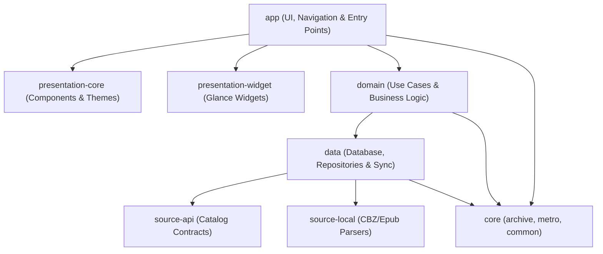

<p align="center">
  
</p>

# Hikari

[](https://github.com/HikariCollection/hikari/releases)
[](https://github.com/HikariCollection/hikari/actions)
[](https://developer.android.com)
[](LICENSE)

A high-performance, open-source manga reader for Android built with Kotlin and Jetpack Compose.
Focused on native Material 3 design, zero telemetry, and extensive reader customization.

---

## Why Hikari?

- **Distraction-Free Reading**: Multiple reading modes including left-to-right, right-to-left, continuous vertical, and webtoon with subsampling tile decoders for large images.
- **Modern Material 3**: Native Material 3 Expressive theming, dynamic Monet palette extraction on Android 12+, and full edge-to-edge system insets.
- **Privacy by Default**: No analytics, telemetry, crash trackers, or background polling bloat.
- **Robust Backup & Migration**: Dedicated `.hkbackup` archives with full backward compatibility for legacy `.tachibk` restores.
- **Native Extension Ecosystem**: Modular online catalog support with source management, search, and download caching.

---

## Quickstart

### Prerequisites

- Android SDK with API 36 (`compileSdk = 36`, `targetSdk = 36`)
- Java Development Kit (JDK) 17 or higher
- Android device or emulator running Android 8.0 (API 26) or higher

### Building from Source

```bash
# Clone the repository
git clone https://github.com/HikariCollection/hikari.git
cd hikari

# Build the debug APK
./gradlew assembleDebug

# Install onto a connected Android device via ADB
adb install -r app/build/outputs/apk/debug/app-arm64-v8a-debug.apk
```

### Running Quality Verification

```bash
# Verify code formatting and lint rules
./gradlew spotlessCheck

# Run the unit test suite
./gradlew testDebugUnitTest
```

---

## Release Signing

To sign release builds locally, copy the example properties template and provide your keystore credentials:

```bash
cp keystore.properties.example keystore.properties
```

Edit `keystore.properties` with your keystore path, alias, and passwords. Both `keystore.properties` and `*.jks` files are ignored by version control.

---

## Architecture

Hikari is engineered as a modular multi-project Gradle application:



### Repository Layout

```text
hikari/
├── app/                  # Main Android application and Compose screens
├── core/                 # Shared low-level utilities (archive, metro, common)
├── core-metadata/        # ComicInfo and metadata schema parsers
├── data/                 # Room/SQLDelight database, preferences, and backups
├── domain/               # Reactive use cases and domain models
├── i18n/                 # Multiplatform localization resources
├── presentation-core/    # Shared Compose components and color tokens
├── presentation-widget/  # Glance home-screen widget implementations
├── source-api/           # Contracts and interfaces for manga sources
└── source-local/         # Local archive and folder manga readers
```

---

## Advanced Build Options

<details>
<summary><strong>View Gradle build tasks and flags</strong></summary>

| Task | Command | Description |
| :--- | :--- | :--- |
| **Debug Build** | `./gradlew assembleDebug` | Generates per-ABI debug APKs |
| **Release Build** | `./gradlew assembleRelease` | Generates optimized release APKs |
| **Spotless Apply** | `./gradlew spotlessApply` | Formats Kotlin, XML, and Gradle files |
| **Unit Tests** | `./gradlew testDebugUnitTest` | Executes local JVM test suite |
| **Lint Check** | `./gradlew lintDebug` | Runs Android Lint inspections |

</details>

---

## License & Attribution

Hikari is open source software licensed under the [Apache License, Version 2.0](LICENSE).

Hikari is a derivative work of [Mihon](https://github.com/mihonapp/mihon) and [Tachiyomi](https://github.com/tachiyomiorg/tachiyomi). See [NOTICE](NOTICE) for complete attribution.
